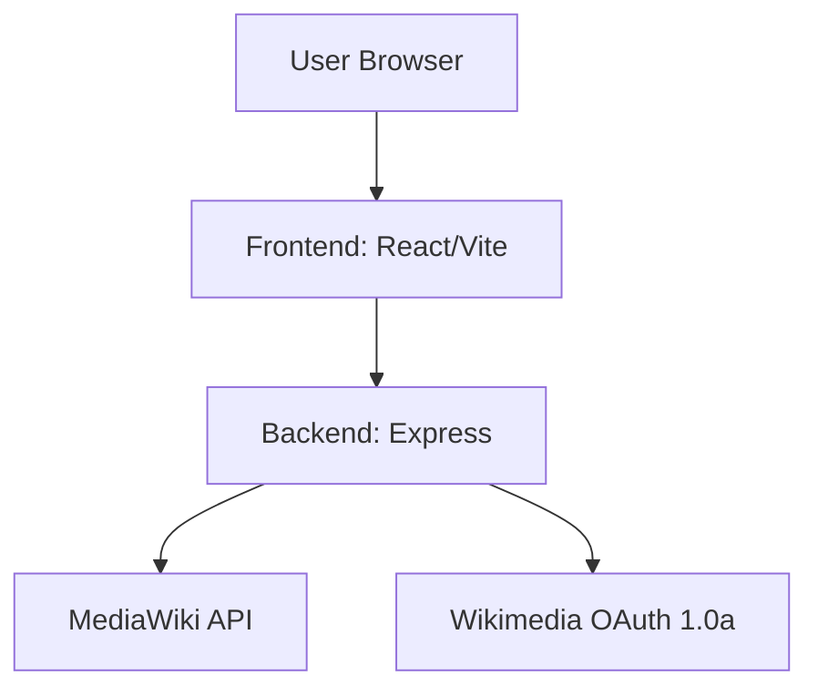

# WikiWish

[](LICENSE)
[](https://www.typescriptlang.org/)

**WikiWish: Your wishes, all in one place.**

Explore, track and discover Community Wishlist contributions.

## Overview

WikiWish is an independent, community-built web application that helps Wikimedia contributors keep track of their Community Wishlist activity.

### Features

- **Created by me**: See all wishes you've submitted to the Community Wishlist
- **Supported by me**: Discover wishes you've voted for or supported
- **User Explorer**: Browse other Wikimedia contributors' wishlist activity
- **Modern UI**: Clean, responsive design with light and dark themes

### Screenshots


## Technology Stack

| Layer | Technology |
|-------|------------|
| Frontend | React 18, TypeScript, Vite, Tailwind CSS |
| Backend | Node.js, Express, TypeScript |
| State Management | TanStack Query (React Query) |
| Routing | React Router DOM |
| UI Components | Custom components with Lucide icons |
| Authentication | Wikimedia OAuth 1.0a |
| API | MediaWiki Action API (Meta-Wiki) |

## Architecture



See [Architecture Documentation](docs/ARCHITECTURE.md) for detailed system design.

## Quick Start

### Prerequisites

- Node.js 18+ or later
- npm or yarn
- Git

### Setup

```bash
git clone https://github.com/wikiwish/wikiwish.git
cd wikiwish

# Create environment files
cp frontend/.env.example frontend/.env
cp backend/.env.example backend/.env
```

### Development

```bash
# Terminal 1: Backend
npm run dev --prefix backend

# Terminal 2: Frontend
npm run dev --prefix frontend
```

Open [http://localhost:3000](http://localhost:3000) in your browser.

### OAuth for Testing

To test the full OAuth flow, you need OAuth credentials from Wikimedia:

1. Go to https://meta.wikimedia.org/wiki/Special:OAuthConsumerRegistration/propose
2. Propose a consumer with callback: `http://localhost:8080/api/auth/callback`
3. Copy the key and secret to `backend/.env`

## API Endpoints

| Route | Description |
|-------|-------------|
| `GET /` | Home page |
| `GET /dashboard` | Personal dashboard |
| `GET /dashboard/created` | Wishes created by you |
| `GET /dashboard/supported` | Wishes supported by you |
| `GET /explore` | Browse wishes |
| `GET /user/:username` | Contributor profile |
| `GET /wish/:id` | Wish details |
| `GET /about` | About page |

See [API Documentation](docs/API.md) for complete API reference.

## Deployment

WikiWish can be deployed to:

1. **Wikimedia Toolforge** (Recommended)
2. **Any Node.js compatible host**

See [Deployment Guide](docs/DEPLOYMENT.md) for detailed instructions.

### Toolforge Deployment

```bash
# SSH into Toolforge
ssh username@tools.toolforge.org

# Deploy your tool
# Set environment variables and start service
webservice --site=meta-wiki start
```

## Development

### Project Structure

```
wikiwish/
├── frontend/              # React frontend
├── backend/               # Node.js backend
├── docs/                  # Documentation
└── package.json
```

### Available Scripts

```bash
npm run dev --prefix backend    # Start backend dev server
npm run build --prefix backend  # Build backend for production
npm run dev --prefix frontend   # Start frontend dev server
npm run build --prefix frontend # Build frontend for production
```

## OAuth Configuration

WikiWish uses Wikimedia OAuth 1.0a for authentication.

### Required Environment Variables

| Variable | Description |
|----------|-------------|
| `OAUTH_CONSUMER_KEY` | OAuth consumer key |
| `OAUTH_CONSUMER_SECRET` | OAuth consumer secret |
| `OAUTH_CALLBACK_URL` | OAuth callback URL |
| `SESSION_SECRET` | Random session secret |
| `CORS_ORIGINS` | Allowed origins (comma-separated) |

See [Authentication Guide](docs/AUTHENTICATION.md) for OAuth setup.

## Data Sources

WikiWish uses public data from Meta-Wiki:

- **Community Wishlist**: https://meta.wikimedia.org/wiki/Community_Wishlist
- **MediaWiki Action API**: https://meta.wikimedia.org/w/api.php
- **CommunityRequests Extension**: Handles wishlist storage

## Privacy

WikiWish is privacy-conscious:

- Only uses public Meta-Wiki data
- OAuth tokens stored in session, not persisted
- No collection of personal information beyond username
- No tracking or analytics

## Contributing

1. Fork the repository
2. Create a feature branch: `git checkout -b feature/my-feature`
3. Make your changes
4. Run tests and linting
5. Submit a pull request

Please read [Contributing Guidelines](CONTRIBUTING.md) before submitting.

## Issues

Report bugs and request features at:
https://github.com/wikiwish/wikiwish/issues

## License

MIT License - see [LICENSE](LICENSE) for details.

WikiWish is an independent, community-built tool and is not affiliated with or endorsed by the Wikimedia Foundation.

## Support

- GitHub Issues: https://github.com/wikiwish/wikiwish/issues
- Wikimedia Cloud Services: https://wikitech.wikimedia.org/wiki/Portal:Toolforge
- Chat: Join #wikimedia-cloud on IRC or Telegram