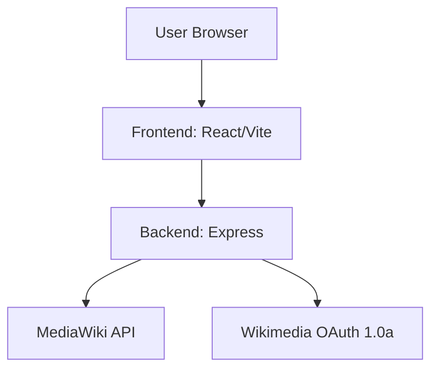

# WikiWish

[](LICENSE)
[](https://www.typescriptlang.org/)

**WikiWish: Your wishes, all in one place.**

Explore, track and discover Community Wishlist contributions.

## Overview

WikiWish is an independent, community-built web application that helps Wikimedia contributors keep track of their Community Wishlist activity.

### Features

- **Created by me**: See all wishes you've submitted to the Community Wishlist
- **Supported by me**: Discover wishes you've voted for or supported
- **User Explorer**: Browse other Wikimedia contributors' wishlist activity
- **Modern UI**: Clean, responsive design with light and dark themes

## Technology Stack

| Layer | Technology |
|-------|------------|
| Frontend | React 18, TypeScript, Vite, Tailwind CSS |
| Backend | Node.js, Express, TypeScript |
| State Management | TanStack Query (React Query) |
| Routing | React Router DOM |
| UI Components | Custom components with Lucide icons |
| Authentication | Wikimedia OAuth 1.0a |
| API | MediaWiki Action API (Meta-Wiki) |

## Quick Start

### Prerequisites

- Node.js 18+ or later
- npm or yarn
- Git

### Setup

```bash
git clone https://github.com/wikiwish/wikiwish.git
cd wikiwish

# Create environment files
cp frontend/.env.example frontend/.env
cp backend/.env.example backend/.env
# Edit backend/.env with your OAuth credentials

# Install dependencies
npm install
cd frontend && npm install
cd ../backend && npm install

# Run development servers
npm run dev --prefix backend  # http://localhost:8080
npm run dev --prefix frontend  # http://localhost:3000
```

## Architecture



## Deployment

WikiWish can be deployed to Wikimedia Toolforge or any Node.js compatible host.

See [docs/DEPLOYMENT.md](docs/DEPLOYMENT.md) for detailed instructions.

## Development

See [docs/DEVELOPMENT.md](docs/DEVELOPMENT.md) for development guidelines.

## Contributing

See [CONTRIBUTING.md](CONTRIBUTING.md) for contribution guidelines.

## License

MIT License

WikiWish is an independent, community-built tool and is not affiliated with or endorsed by the Wikimedia Foundation.