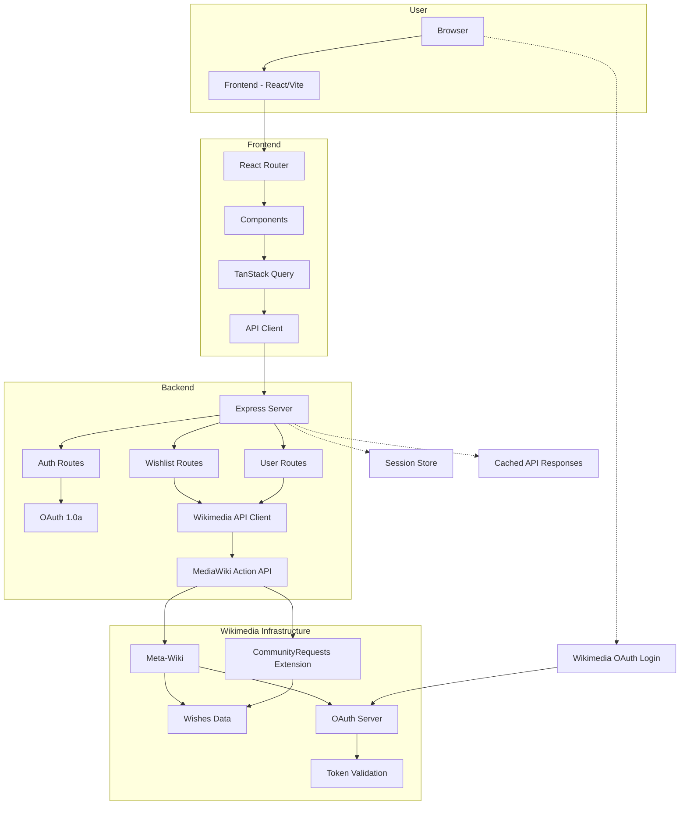

# WikiWish Architecture

## Overview

WikiWish is a web application that helps Wikimedia contributors track their Community Wishlist activity. This document describes the system architecture, data flow, and technical decisions.

## Architecture Diagram

## System Components

### Frontend (React + Vite + TypeScript)

- **AppShell**: Main layout component with navbar, sidebar, and footer
- **Components**: Reusable UI components (WishCard, StatusBadge, EmptyState, etc.)
- **Hooks**: Custom React hooks for auth, theme, and data fetching
- **Routes**: Client-side routing with React Router DOM

### Backend (Node.js + Express + TypeScript)

- **Routes Layer**: RESTful API endpoints
  - `/api/auth` - OAuth authentication
  - `/api/wishes` - Wishlist data retrieval
  - `/api/users` - User-specific wish queries

- **Service Layer**: Wikimedia API client
  - Handles MediaWiki Action API requests
  - Implements rate limiting and concurrency control
  - Parses HTML responses for detailed wish data

- **Session Management**: Express session-based auth
  - Stores OAuth tokens temporarily
  - Tracks authenticated user state

### External Dependencies

- **Meta-Wiki API**: MediaWiki Action API for wishlist data
- **CommunityRequests Extension**: Stores wishlist items as wiki pages
- **OAuth Server**: Wikimedia OAuth 1.0a for authentication

## Data Flow

### Authentication Flow

1. User clicks "Sign in with Wikimedia"
2. Backend redirects to Meta-Wiki OAuth
3. User grants permissions on Meta-Wiki
4. Meta-Wiki redirects back with OAuth token
5. Backend exchanges token for access token
6. Access token is stored in session
7. User profile is fetched and session is created

### Wish Data Retrieval

1. List wishes: `list=communityrequests-wishes` API
2. Parse HTML for details: `action=parse` API
3. Extract author, description, supporters from HTML
4. Cache responses where appropriate

### User Activity Queries

1. **Created wishes**: Search for wishes where user appears as author
2. **Supported wishes**: Search for wishes with user in supporter list
3. Both queries filter parsed API results

## Design Decisions

### Why Node.js/Express Backend?

- Better tooling for OAuth 1.0a signing (cryptoutil)
- Lightweight and fast for API proxy
- Easy deployment to Toolforge
- TypeScript support for type safety

### Why Parse HTML for Detailed Data?

The CommunityRequests extension doesn't expose a dedicated API module for:
- Author information
- Detailed descriptions
- Supporter lists

The API returns basic wish metadata, but full details require parsing the wiki page HTML. This is a compliant approach that uses the public parse API rather than unofficial scraping.

### Rate Limiting

- Implemented client-side request throttling
- Maximum 3 concurrent requests
- 100ms minimum interval between requests
- Proper error handling for HTTP 429

### Session Management

- 24-hour session lifetime
- HTTP-only, secure cookies
- OAuth token refresh not implemented (would require token persistence)

## Limitations

1. **Supporter Lists**: Requires parsing HTML from each wish page
2. **Pagination**: Limited to 500 wishes in user queries
3. **Real-time Updates**: Data is fetched fresh each request (no WebSocket updates)
4. **OAuth Scope**: Only basic user info available (no email, preferences)

## Future Improvements

1. Server-side caching (Redis) for API responses
2. Background job to sync wishlist data
3. WebWorkers for parallel parsing
4. Improved pagination for large wishlists